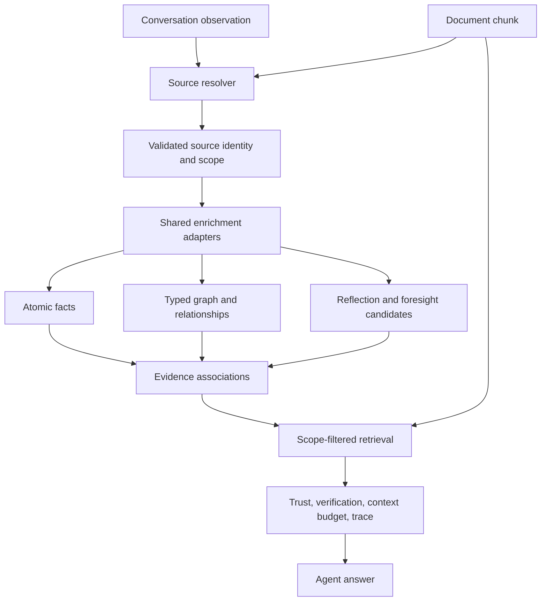

# Unified evidence architecture

This document tracks the source-aware memory rollout described in
[ADR 0006](adr/0006-unified-evidence.md). The implementation is staged; a feature
is available in production only after its gate and rollout flag are verified.

## Current system and extension points

| Input | Source of truth | Current processing |
| --- | --- | --- |
| Conversation | `observations` in SQLite | Fast path, observation queue, slow path, facts, graph, reflection, foresight |
| Document | Private S3 original and `documents`/`document_chunks` in SQLite | Extraction, chunking, Chroma index, raw chunk retrieval |

The observation queue and Session Working Set are conversation-specific. The
document enrichment queue is separate so a document is never represented as a
user observation.

## Scope contract

Every source and derived record has a workspace boundary. Project and namespace
identities are resolved from the authenticated API key, never from a caller's
workspace ID. A Knowledge Base belongs to one workspace and must be explicitly
allowed before its chunks or derived claims enter retrieval. Personal observations
stay in their namespace workspace. Project knowledge requires a separate project
scope and explicit attachment. `memories:read` does not grant document access;
project-key retrieval also requires `documents:read` before reading document
candidates.

Normal chat retrieval uses the session's explicit
`session_knowledge_base_attachments` allowlist. An empty attachment list, a
missing session, or a disabled `MIRA_SOURCE_AWARE_RETRIEVAL` rollout flag returns
no document candidates. The app exposes that allowlist in Knowledge Bases as
“Use in this chat”; the API is `GET`/`PUT /sessions/{session_id}/knowledge-bases`.
Project-shared document workspaces are recorded in
`project_knowledge_workspaces`, so project rollout allowlists also reach the
document enrichment worker.

## Rollout and recovery

`MIRA_DOCUMENT_ENRICHMENT_ENABLED` and `MIRA_SOURCE_AWARE_RETRIEVAL_ENABLED`
default to false. Each also requires a selected workspace or project ID list.
Enrichment failures leave the already-ready document searchable. Disable both
flags to stop new source-aware processing while preserving the conversation path.

Before enabling a migrated production database, create and verify a SQLite
backup with SQLite's online backup command, then record row counts and run
`PRAGMA foreign_key_check`. Roll back by disabling the flags and restoring the
verified backup only after stopping API and worker writes. Keep the private S3
originals under their existing retention policy.

## Stage 0 baseline

On `deploy/coolify-contabo` at `0762689`, the focused baseline command
`.venv/bin/pytest -q --no-cov tests/knowledge/test_documents.py
tests/test_repositories.py tests/test_developer_platform.py` completed with
27 passed and 2 skipped. The previous GitHub CI run for that commit passed the
full 637-test suite. New stage gates must be verified again after implementation.
